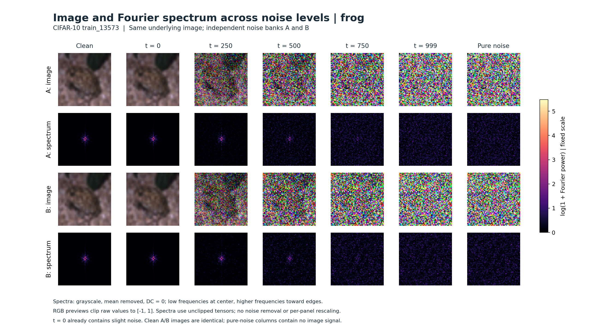
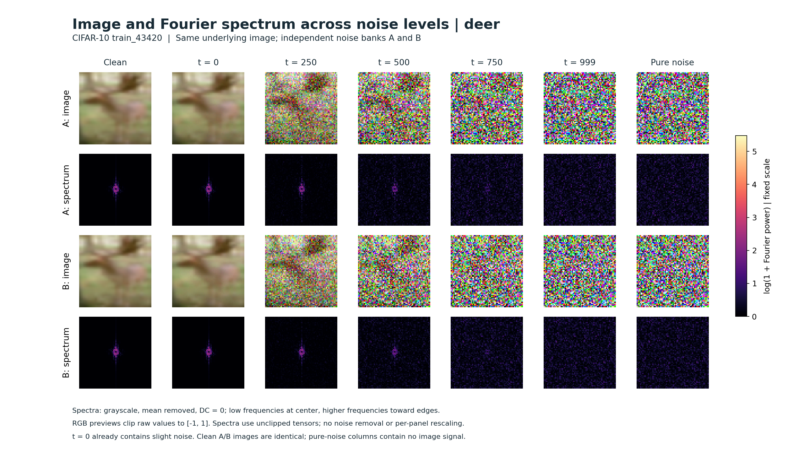
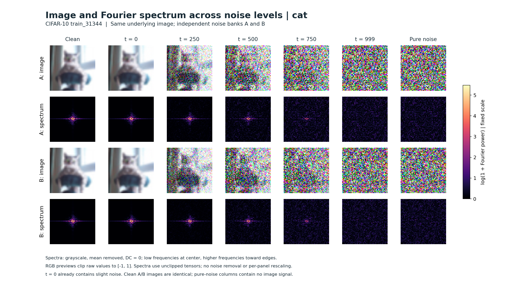
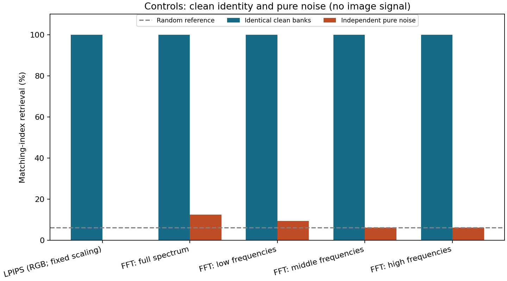
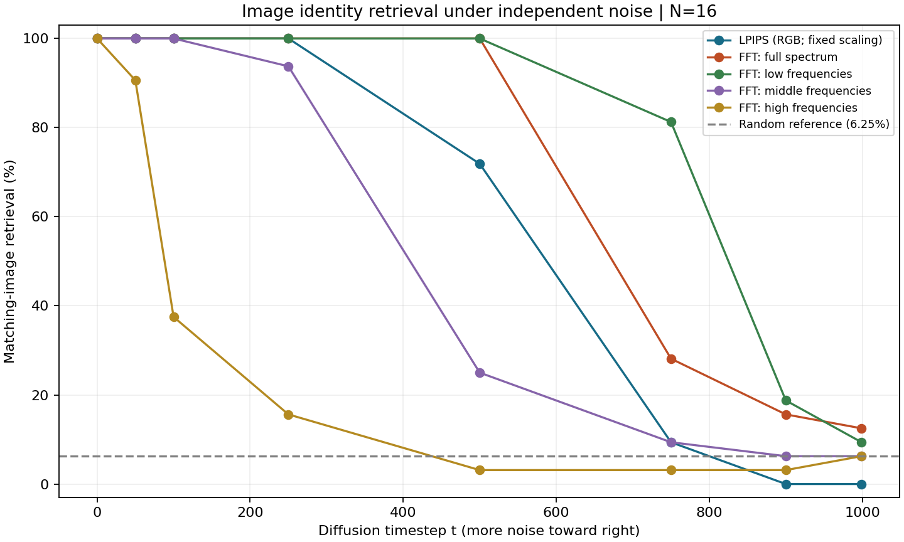
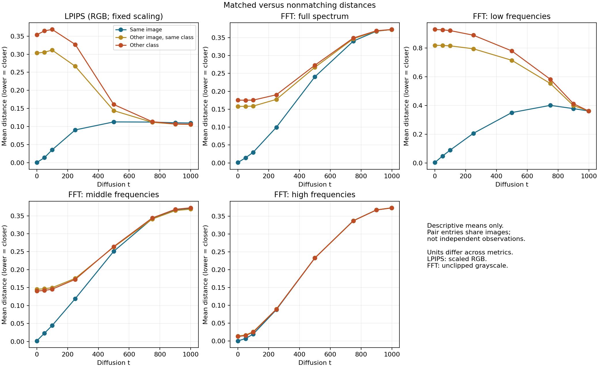
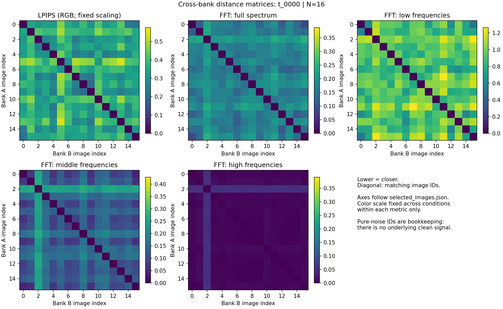
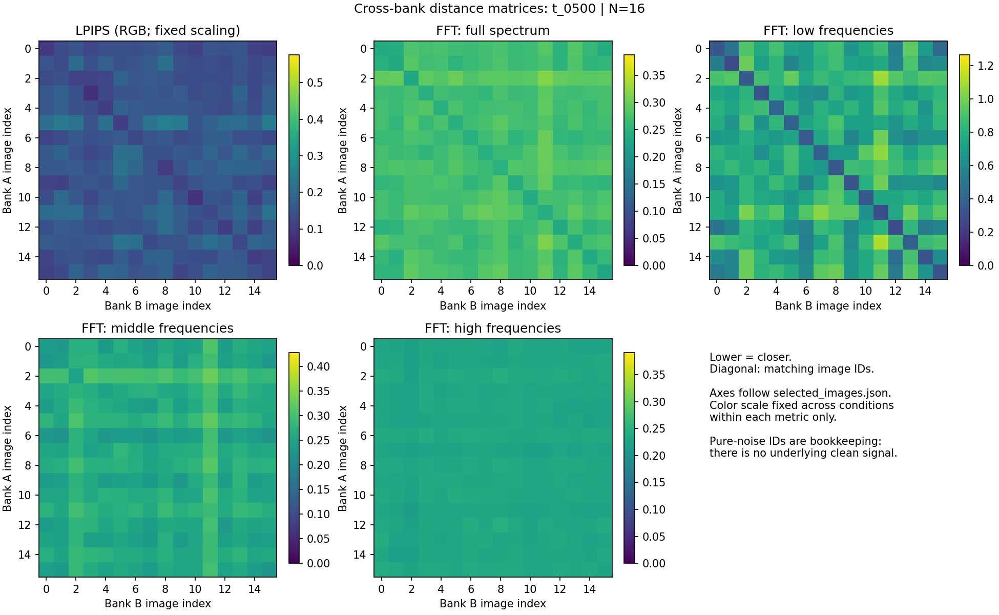
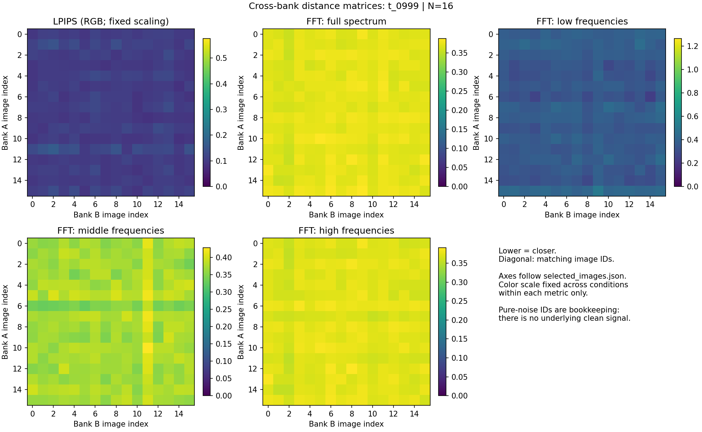
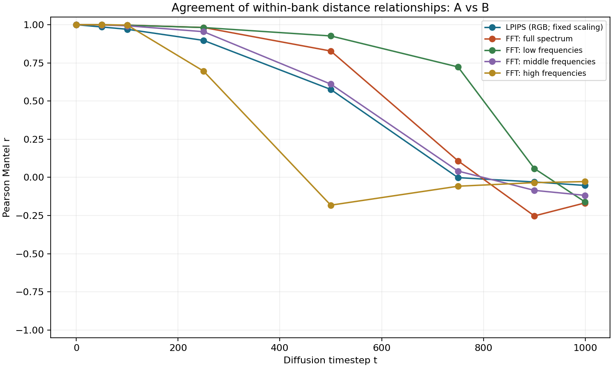

# Experiment 1: Image similarity under independently added diffusion noise

Date: October 21, 2026

**Review status:** Preparation and analysis were run on the server. Confirm
`analysis_manifest.json` reports `status: complete` before treating the output as
finished. Numerical findings and plot interpretations below are pending review.

## 1. Experimental setup

### Purpose

How well do LPIPS and Fourier-based distances distinguish the same underlying
image with independent noise from different underlying images, and how does
that ability change with diffusion timestep t?

This is a controlled measurement experiment. No independently trained diffusion
model generates these images. The trained models provide the noise-schedule
configuration only. Comparing their denoising trajectories is Experiment 2,
which is not part of this report.

**Reading guide:** A/B identify independent noise banks, not trained models. Diffusion timestep t controls noise strength; it is not a model training checkpoint.

| Item | Setting |
|---|---|
| Dataset | Official CIFAR-10 training split; membership in the models' actual training subset is not established |
| Sample | 16 fixed images, approximately class-balanced; indices and labels saved |
| Image preprocessing | Original 32x32 RGB retained; Pillow bilinear resize to 64x64, then uint8 / 127.5 - 1 |
| Noise schedule | Saved matching DDPM configurations: 1,000 timesteps, squaredcos_cap_v2 |
| Evaluated t | 0, 50, 100, 250, 500, 750, 900, 999 |
| Prepared noisy states | 16 images x 2 noise banks x 8 timesteps = 256 |
| Controls | Identical clean banks; independent pure-noise banks |
| Model training or inference | None |

For each image and bank, the same noise tensor is reused across t. The noise
strength changes according to the schedule. These are coupled forward-noise
snapshots, not a simulated Markov forward trajectory. The clean reference is
separate from scheduler t=0, which already contains a small amount of noise.

Image IDs: [selected images](results/cifar10_noise_similarity_001/selected_images.json).
Preparation details: [manifest](provenance/preparation_manifest.json) and
[repeatability checks](provenance/repeatability.json).

## 2. Visual demonstration: images and Fourier spectra

### Figure 1. Actual images and their Fourier spectra

The first three saved image IDs are shown below (selected in saved order, not
chosen for a particular visual result). Each column uses the same underlying
image at a selected noise level. Rows show image A, spectrum A, image B, and
spectrum B. A and B have independent noise; these are not model-generated images.

#### Frog: train_13573



#### Deer: train_43420



#### Cat: train_31344



**How to read the spectra:** Low frequencies are centered; higher frequencies
are farther from the center. Brightness encodes log(1 + Fourier power), not image
similarity. The DC bin is zero because the spatial mean was removed. All panels
share one color range, from zero to the maximum across all 16 images, both banks,
and all 10 saved conditions. There is no per-image contrast normalization.

**Visual observation:** In these three examples, clean and lightly noised spectra
have concentrated low-frequency power. As noise increases, a more widespread
speckled pattern becomes visible and the low-frequency concentration weakens.
The t=999 and pure-noise panels look very similar within each bank; the same
bank's noise tensor is reused across t. A/B speckles differ because the noise
banks are independent. These are qualitative demonstrations, not an additional
statistical test or evidence of memorization/generalization.

**Display caveat:** RGB previews clip raw values to [-1, 1] and map them to
[0, 1]. Fourier spectra are computed from unclipped raw tensors, not from these
clipped previews. Spectra omit phase and do not remove noise. Scheduler t=0
already contains slight noise; the clean reference is separate.

**Verification:** Recomputed spectra matched the saved arrays for all 224
image/bank/condition combinations used as sources (16 images, two banks, seven
displayed conditions), with maximum absolute error below 1.3e-15.
See the [panel provenance and checks](results/cifar10_noise_similarity_001/figures/spectrum_panels_manifest.json).

## 3. Numerical summary: matching the same image

For each image in bank A, find the closest candidate among the 16 images in bank
B; repeat B-to-A and average the two accuracies. A correct match means the same
original image ID, not merely the same class. Higher retrieval is better.

The table shows selected measured timesteps. The graphs in the next section
include all eight measured timesteps.

| Diffusion timestep t | LPIPS | FFT full | FFT low | FFT middle | FFT high |
|---|---:|---:|---:|---:|---:|
| 250 | 100% | 100% | 100% | 93.75% | 15.63% |
| 500 | 71.88% | 100% | 100% | 25.00% | 3.13% |
| 750 | 9.38% | 28.13% | **81.25%** | 9.38% | 3.13% |
| 999 | 0% | 12.50% | 9.38% | 6.25% | 6.25% |

Source: [summary.csv](results/cifar10_noise_similarity_001/summary.csv),
`retrieval_mean × 100`, rounded to two decimal places where needed.
The random-reference rate is 1/16 = 6.25%; it is not a significance threshold.

**Main descriptive result:** Low-frequency FFT retains the highest matching
accuracy among the tested measures at t=750 in this 16-image pilot.
This is not a claim that FFT is universally better than LPIPS, or a test of
memorization versus generalization.

**Two different questions:** Retrieval asks whether a noisy image finds its
matching original ID in the other bank. Mantel correlation asks whether the
pairwise distance relationships within bank A agree with those within bank B.
A high Mantel correlation does not guarantee high matching accuracy.


## 4. Supporting graphs and heatmaps

### Figure 2. Control checks



**Observation:** [Report clean and pure-noise retrieval for each metric. Do not
assume that one finite pure-noise sample must give exactly 6.25%.]

**Evidence:** [summary.csv rows with kind = clean_control or pure_noise_control;
metric and retrieval_mean. Multiply retrieval fractions by 100 for percentages.]

### Figure 3. Matching-image retrieval across noise levels



**Observation:** [Describe how retrieval changes with t and how the metrics
differ. Do not assume a monotonic pattern or that FFT performs better.]

**Evidence:** [Selected timestep, metric, retrieval_a_to_b, retrieval_b_to_a,
retrieval_mean; inspect per-image ties if relevant.]

### Figure 4. Matching versus nonmatching distances



**Observation:** [Within each metric, describe whether matching-image distances
remain lower than nonmatching distances. Discuss any loss of separation.]

**Evidence:** [matched_mean, same_class_nonmatched_mean, different_class_mean,
and their group counts. Use the full distributions for additional inspection.]

### Figure 5. Cross-bank distance matrices

#### Low noise: t=0 (not the clean reference)



#### Intermediate noise: t=500



#### High noise: t=999



**Observation:** [Describe diagonal-versus-off-diagonal structure. Color scales
are fixed across conditions within each metric, not shared across metrics.]

### Figure 6. Within-bank relationship agreement



**Observation:** [Describe which image-distance relationships remain similar
between independent noise banks and how this varies with t.]

**Evidence:** [metric, timestep, r, p_holm_all, and mantel_status in summary.csv.]

High Mantel correlation does not mean corresponding images are identical.
Small individual p-values do not show that differences between metrics or
timesteps are statistically significant.

## 5. Interpretation and limitations

**Main supported finding:** [Complete only after reviewing actual outputs.]

**Implication for Experiment 2:** [Which measurements appear useful for examining
denoising trajectories, and at which noise levels do they become difficult to interpret?]

Limitations:

- Only 16 images and one independent A/B noise-bank pair; this is a pilot.
- Pairwise entries reuse images. The two retrieval directions and timesteps are
  not independent replicate experiments. No independent-pair error bars are used.
- 32-to-64 resizing changes frequency content; original-resolution sensitivity
  analysis has not yet been performed in this run.
- LPIPS scaling/clipping, grayscale conversion, omitted phase, and selected
  frequency cutoffs can influence the findings.
- Pure-noise IDs have no underlying image signal; their class labels are only
  inherited bookkeeping.
- This experiment does not establish what independently trained models learned,
  or whether they memorize or generalize.

## 6. Next steps

- [ ] Review the completion and control checks.
- [ ] Fill the Results section from the actual CSV/JSON and figures.
- [ ] Consider a larger class-balanced sample and additional independent noise-bank pairs.
- [ ] Check sensitivity to original 32x32 resolution and the fixed LPIPS mapping.
- [ ] Proceed to Experiment 2: save intermediate denoising states from the existing
  models at a fixed training checkpoint, then compare aligned states.

## 7. Appendix: measurement details

### LPIPS

Pretrained LPIPS-AlexNet v0.1, with fixed input mapping
`clamp(raw, -4, 4) / 4` for every image, noise level, and control. Lower values
mean closer representations. Per-condition clipping fractions are saved.
No per-image min/max normalization is used. Reliability on strongly noised,
rescaled images is an experimental question, not an assumption.

### Fourier-based distances

Unclipped raw RGB tensors are converted to grayscale, spatially mean-centered,
and transformed with an orthonormal 2D FFT. The DC bin is omitted. Features are
`log1p(abs(FFT)^2)`, discarding phase. Distance is the RMS difference between
features over the selected frequency bins.

| Band | Radial frequency in cycles per target-image pixel |
|---|---|
| Full | All non-DC bins |
| Low | 0 < r <= 0.1 |
| Middle | 0.1 < r <= 0.25 |
| High | r > 0.25 |

FFT does not automatically remove noise. LPIPS uses scaled RGB, whereas FFT uses
unclipped grayscale; differences between their results cannot be attributed
solely to perceptual versus frequency information. Their raw distance values
have different units and should not be directly compared numerically.

### Matrices and retrieval

- Cross-bank matrix: row i is image i from A, column j is image j from B.
  Diagonal entries compare matching image IDs; off-diagonal entries compare
  different images. This matrix need not be symmetric.
- Within-bank matrices: pairwise distances among A images and among B images.
  These are the symmetric matrices compared by the Mantel test.
- Retrieval: use each A image to find its nearest B image, then repeat in the
  opposite direction. Report the mean of the two directional accuracies.
  Ties receive fractional credit. Random-reference accuracy is 1/16 = 6.25%.
- Compare matched images, nonmatching images in the same class, and different
  classes. Some classes have only one selected image and therefore no same-class
  nonmatching partner.
- Mantel: Pearson correlation, 9,999 joint row/column label permutations,
  two-sided p-values, Holm correction across valid noisy and pure-noise tests.
  The identical clean control is excluded from significance testing.

## 8. Appendix: execution and verification

| Check | Result to record after inspection |
|---|---|
| Analysis status | [From analysis_manifest.json: status] |
| LPIPS repeatability | [lpips.preflight_checks.repeated_pair_exact] |
| LPIPS self-distance | [lpips.preflight_checks.max_self_distance] |
| Number of metric/condition rows | [n_metric_conditions; expected 50 for this setup] |
| Number of valid Mantel tests | [n_mantel_tests; expected 45 if all eligible matrices are nonconstant] |
| Undefined Mantel tests | [undefined_mantel_tests] |
| LPIPS clipping fractions | [conditions: lpips_clipped_fraction_A and lpips_clipped_fraction_B] |
| Exact raw matches | [conditions: raw_exact_pairs; distinguish clean control from noisy states] |

Source: [analysis manifest](results/cifar10_noise_similarity_001/analysis_manifest.json).

## 9. Evidence and reproducibility

- [Numerical summary CSV](results/cifar10_noise_similarity_001/summary.csv)
- [Numerical summary JSON](results/cifar10_noise_similarity_001/summary.json)
- [Per-image retrieval](results/cifar10_noise_similarity_001/per_image_retrieval.csv)
- [All cross-bank pair distances](results/cifar10_noise_similarity_001/pair_distances.csv)
- [Analysis settings, input checks and hashes](results/cifar10_noise_similarity_001/analysis_manifest.json)

Full distance matrices and Fourier features are retained in the complete local
download and on the server; they are not included in this report repository.

Server locations:

```text
/yunity/poil08/cifar10_forward_noise_001/
/yunity/poil08/cifar10_noise_similarity_001/
```

Keep the raw preparation tensors and both scripts as reproducibility records.
They need not all be embedded in the Markdown or uploaded to GitHub. Record the
script versions used; the manifests include script and input hashes.

