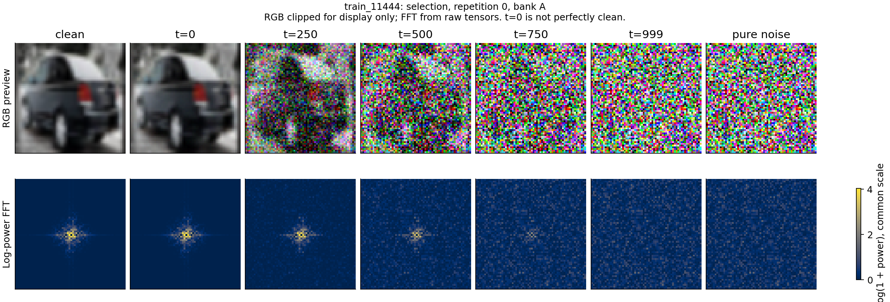
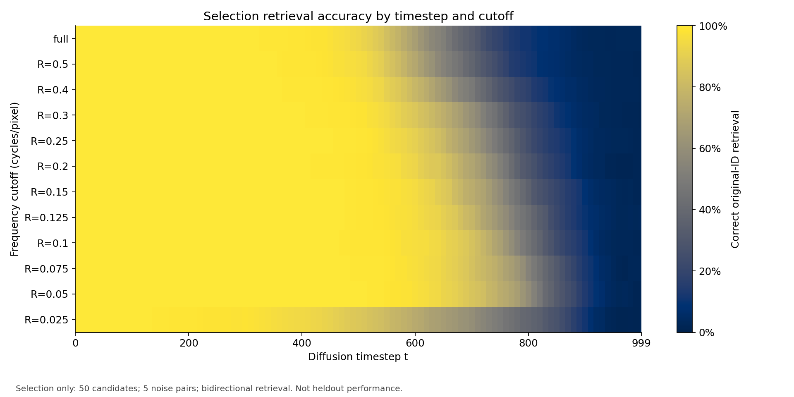
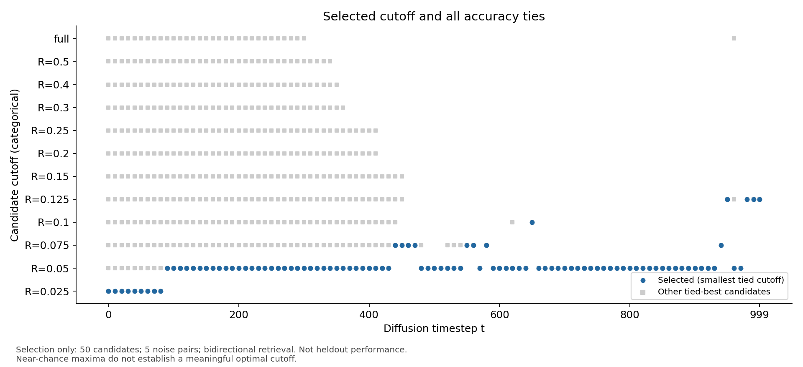
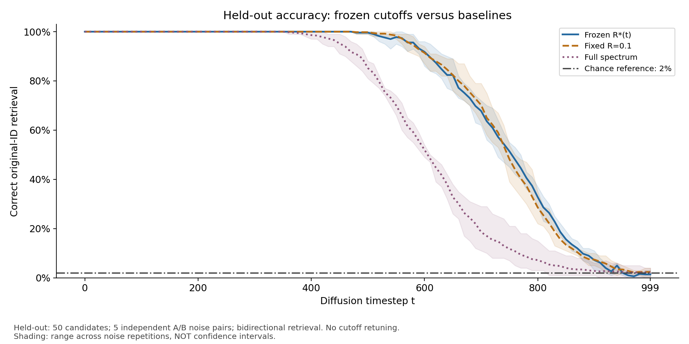
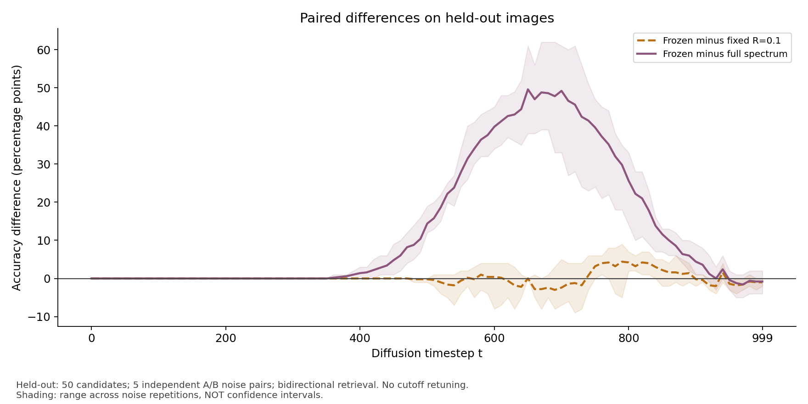
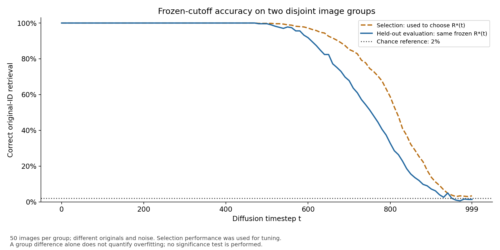

# CIFAR-10: Fourier cutoff selection under diffusion noise

**Date:** October 28, 2026  
**Study:** 100 original images, split into 50 for cutoff selection and 50 for held-out evaluation.

## Executive summary

Restricting image matching to low-frequency Fourier features preserved matching accuracy longer than using the full spectrum on the held-out images. At diffusion timestep **t=800**, the frozen, selection-chosen cutoff achieved **32.8%** accuracy, compared with **7.2%** for full-spectrum matching. However, its advantage over the previous fixed cutoff **R=0.1** was smaller and inconsistent: **32.8% versus 28.6%** at t=800, but **67.8% versus 70.2%** at t=700. These are descriptive results, not statistical-significance claims. [[1]](sources/evaluation/accuracy_summary.csv)

This completes the planned 50/50 experiment. It supports the usefulness of low-frequency-restricted matching in this setup, but does **not** establish that timestep-specific cutoff selection consistently beats fixed R=0.1 or that a universal optimal-cutoff rule has been found.

## 1. Research question and experimental setup

**Question:** As diffusion noise increases, which Fourier frequency cutoff best preserves our ability to match two independently noised versions of the same original image?

Here, **t** is a diffusion noise timestep, not a model-training checkpoint. **R** is the maximum radial frequency included in the comparison, not a correlation coefficient or a threshold for declaring a match.

| Setting | Value |
|---|---|
| Dataset | CIFAR-10, official training split |
| Original images | 100 distinct images; 10 per class |
| Selection group | 50 images; 5 per class |
| Evaluation group | Different 50 images; 5 per class; no overlapping IDs |
| Image preparation | RGB, resized from 32×32 to 64×64 using Pillow bilinear interpolation; normalized to [-1, 1] |
| Noise schedule | 1,000-step cosine schedule (`squaredcos_cap_v2`), from the saved preparation |
| Analyzed timesteps | 0, 10, 20, …, 980, 990, 999: **101 timesteps** |
| Noise repetitions | Five independent A/B noise-bank pairs per group |
| Retrieval candidates | 50 images in the other bank |
| Random-match reference | 1/50 = **2%** |
| Comparisons | Frozen selection-chosen R*(t), fixed R=0.1, and full spectrum |

The grouping, preparation and analysis methods are recorded in the [selection protocol](sources/selection/protocol.json) and [evaluation protocol](sources/evaluation/evaluation_protocol.json). The official dataset split does not by itself establish whether these particular images were used to train any previously obtained model.

### What banks A and B mean

Both banks contain versions of the **same originals**, but independently added noise:

- A particular car image in bank A has a corresponding version of that exact original in bank B.
- Its candidates include all 50 images in bank B—not 50 different versions of cars.
- A match is correct only when the retrieved image has the **same original-image ID**. Matching another car does not count.

### How noise was added

For each original image, the saved noisy state follows:

$$
x_t = \sqrt{\bar\alpha_t}\,x_{\mathrm{clean}} + \sqrt{1-\bar\alpha_t}\,\epsilon.
$$

As t increases, the clean-image contribution decreases and the noise contribution increases. Noise is independent across banks, repetitions and groups. **Within one image/bank/repetition, the same epsilon is reused across t**, so this is a controlled, shared-noise-pattern progression—not a simulation of successive Markov diffusion increments.

Scheduler **t=0 is already slightly noised**. An additional clean control contains no added noise, and a pure-noise control contains epsilon alone. The preparation contains 50,500 noisy image states per group, or 101,000 total; these are repeated states of 100 originals, not 101,000 independent images.

## 2. Actual image and Fourier-spectrum progression



**Figure 1.** Actual prepared image `train_11444`, from the **selection group, repetition 0, bank A**. Columns show the clean image, t=0, 250, 500, 750, 999, and pure noise. This is one illustrative example; the matching calculations use all 50 images in each group.

- **Top row:** the image becomes increasingly obscured by noise. RGB values are clipped to [-1, 1] **only for this display**.
- **Bottom row:** centered Fourier log-power spectra of the corresponding **unclipped** tensors. Every panel uses the same color scale. Low frequencies lie near the center; higher frequencies lie farther away. The exact DC bin is removed.
- In this example, low-frequency structure remains visible after the RGB image is heavily corrupted, while the later spectra become more noise-like. The matching analysis below tests whether spectral information still distinguishes the original image from the other candidates.

**FFT does not remove noise.** It represents the image in frequency space. We restrict which frequency features enter the distance calculation; we do not reconstruct or denoise an image using inverse FFT in this experiment. The bottom row shows a Fourier representation computed separately at each noise level, not a second temporal process.

## 3. Fourier features, cutoffs and matching accuracy

For each noisy image, the analysis uses:

1. Raw, unclipped RGB values converted to grayscale with weights (0.299, 0.587, 0.114).
2. Spatial mean subtraction and an orthonormal 2D FFT.
3. Features `log1p(abs(FFT)**2)`, excluding DC and discarding phase.
4. RMS feature differences over the selected frequency bins.

For a cutoff R, the included region is the cumulative disk:

$$
0 < r \leq R, \qquad r = \sqrt{f_x^2 + f_y^2}.
$$

Frequencies are measured in **cycles per prepared-image pixel**. A smaller R includes only lower frequencies; a larger R also includes higher frequencies. Full spectrum means all non-DC bins, including corner frequencies above r=0.5, up to approximately 0.7071.

The prespecified candidates were:

```text
R = 0.025, 0.05, 0.075, 0.1, 0.125, 0.15,
    0.2, 0.25, 0.3, 0.4, 0.5, and full spectrum
```

The candidate with the smallest distance is the predicted match. Accuracy is averaged over **A→B and B→A**, then over the **five noise repetitions**. This corresponds to 500 directional queries per timestep and method, but these queries reuse the same 50 originals and are not independent observations. Distance ties receive fractional 1/k credit if the correct image is among k tied nearest candidates. [[2]](sources/selection/protocol.json)

## 4. Selection: choosing cutoffs using the first 50 images

At each timestep, we selected the candidate with the highest average matching accuracy on the selection group. If several candidates tied, the **smallest cutoff** was chosen, with full spectrum ordered last. No smoothing was applied to R*(t).



**Figure 2.** Each row is a candidate frequency range and each column is a noise timestep. Color represents matching accuracy. Under stronger noise, low-frequency-restricted comparisons retain higher accuracy than broad or full-spectrum comparisons on this selection set. [Source: all selection scores](sources/selection/accuracy_summary.csv).



**Figure 3.** Blue points show the selected cutoff; gray squares show tied-best alternatives. **52 of 101 timesteps have multiple tied-best candidates.** At t=0, all 12 candidates achieve 100%, so choosing R=0.025 reflects the tie rule—not evidence that it is uniquely superior. Changes near almost-pure noise should also not be interpreted as a reliable optimal-frequency law. [Source: frozen choices](sources/selection/selected_cutoffs.json).

### Selected numerical results

| t | Selected R | Selected accuracy | Fixed R=0.1 | Full spectrum |
|---:|---:|---:|---:|---:|
| 250 | 0.05 | 100.0% | 100.0% | 100.0% |
| 500 | 0.05 | 99.8% | 99.2% | 93.4% |
| 700 | 0.05 | 85.2% | 84.4% | 34.0% |
| 750 | 0.05 | 74.6% | 68.4% | 18.6% |
| 800 | 0.05 | 58.8% | 45.4% | 11.0% |
| 900 | 0.05 | 13.8% | 11.6% | 3.2% |
| 999 | 0.125 | 3.4% | 2.2% | 2.8% |

These are **in-sample selection results**, so the chosen method has an advantage from being selected on these same images. [Source: selection results](sources/selection/selected_cutoffs.csv).

## 5. Evaluation: testing the frozen choices on the other 50 images

We preserved the selection protocol, chosen-cutoff file and selection manifest unchanged. The evaluation used **different originals and fresh noise banks**, but applied the exact saved R*(t) at each timestep. It performed **no new cutoff search**.



**Figure 4.** Accuracy on the evaluation group. Shading shows the **range across five noise repetitions**, not confidence intervals. Both low-frequency methods retain matching information longer than full-spectrum matching across much of the noisy range. [Source: evaluation scores](sources/evaluation/accuracy_summary.csv).

### Held-out numerical results

| t | Frozen R | Frozen accuracy | Fixed R=0.1 | Full spectrum |
|---:|---:|---:|---:|---:|
| 250 | 0.05 | 100.0% | 100.0% | 100.0% |
| 500 | 0.05 | 99.6% | 99.8% | 85.2% |
| 700 | 0.05 | 67.8% | 70.2% | 18.6% |
| 750 | 0.05 | 51.4% | 48.2% | 11.8% |
| 800 | 0.05 | 32.8% | 28.6% | 7.2% |
| 900 | 0.05 | 7.2% | 7.4% | 2.8% |
| 999 | 0.125 | 1.4% | 2.4% | 2.2% |

Source: [[1]](sources/evaluation/accuracy_summary.csv). Accuracy means retrieval of the exact original-image ID, not class recognition or image-quality assessment.

### Advantage over the baselines: strong versus full spectrum, mixed versus R=0.1



**Figure 5.** Each curve subtracts baseline accuracy from frozen-cutoff accuracy on the **same evaluation images and noise**. Positive values favor the frozen method; negative values favor the baseline. Shading is the range of paired differences across repetitions, not a confidence interval. [[3]](sources/evaluation/paired_differences.csv)

- At **t=800**, frozen matching scores **32.8% versus 7.2%** for full spectrum: **+25.6 percentage points**.
- At that timestep, the gain over fixed R=0.1 is smaller: **32.8% versus 28.6%**, or **+4.2 points**.
- At **t=700**, the frozen method is worse than fixed R=0.1: **67.8% versus 70.2%**, or **−2.4 points**.

Therefore, the held-out results support restricting the frequency range, but **do not establish consistent superiority of the selected R*(t) over the original fixed R=0.1**. No statistical-significance test was performed.

### Selection and evaluation are not interchangeable



**Figure 6.** The same frozen choices are applied to both groups. At t=800, accuracy is **58.8% on selection versus 32.8% on evaluation**, a decrease of **26.0 percentage points**. The gap must be reported, but it cannot be attributed entirely to overfitting: the groups differ in originals and noise, and selection performance was used for tuning. [[4]](sources/evaluation/selection_vs_evaluation.csv)

## 6. Controls and integrity checks

### Clean and pure-noise controls

Clean-versus-clean matching achieved **100%** for every applied evaluation method. At t=999, the three evaluation means equal their corresponding pure-noise control means:

| Method at t=999 | Noised-image accuracy | Pure-noise control accuracy |
|---|---:|---:|
| Frozen R=0.125 | 1.4% | 1.4% |
| Fixed R=0.1 | 2.4% | 2.4% |
| Full spectrum | 2.2% | 2.2% |

These results are near the **2% chance reference** and do not provide convincing evidence of useful matching at this noise level. Small deviations above or below 2% are not by themselves evidence of significance. Pure-noise results reused at multiple timesteps with the same cutoff are not independent new trials. [[5]](sources/evaluation/control_accuracy.csv)

### Checks performed on the downloaded outputs

- Both run manifests report `status: complete`.
- All 12 recorded selection-output checksums and all 15 recorded evaluation-output checksums matched the downloaded files.
- Evaluation copies of the three frozen files matched the previously reviewed selection files byte-for-byte.
- The recorded selection/evaluation ID lists contain 50 unique IDs each with no overlap.
- All saved summary accuracies, frozen choices, and evaluation paired differences were reproduced from the saved per-query matching credits.
- The evaluation input list contains no selection tensors, and the applied cutoff at each timestep matches the frozen choice.

The scripts recorded checks of 1,010 raw state files per group, including hashes, IDs and forward-noise equations. **The local output review did not independently recompute FFTs from those original raw server tensors.** The large preparation tensors and per-query NPZ files remain in the original run folders; they are not included in this compact report bundle. [[6]](sources/selection/analysis_manifest.json) [[7]](sources/evaluation/analysis_manifest.json)

## 7. Conclusions, limitations and next steps

**Supported conclusion:** Under this CIFAR-10 preparation and noise schedule, low-frequency-restricted FFT features support matching substantially longer than full-spectrum features. That broad advantage carries over to the held-out image group.

**Not established:** A unique optimal cutoff at every timestep, a universal R(t) law, consistent gains from tuning over fixed R=0.1, or statistical significance of the observed differences.

Important limitations:

- Only **50 distinct evaluation images** are used. Five noise repetitions reuse those originals; neighboring timesteps also share noise patterns.
- Resizing 32×32 images to 64×64 changes their spectra. Cutoff units refer to the resized images, and findings should not be transferred unchanged to other resolutions.
- Grayscale log-power features discard color and Fourier phase. Similar spectra do not necessarily imply similar objects or identical images.
- This experiment studies independently noised **real images**, not generated samples from the three trained diffusion models. It does not establish model memorization, model generalization or denoising quality.
- No LPIPS or Mantel analysis was performed in this cutoff-selection/evaluation stage.

The planned 50/50 experiment is complete. Preserve the frozen choices and report favorable and unfavorable comparisons together. If the method is revised after seeing evaluation results, use **new independent images** for the next confirmatory evaluation rather than retuning on these 50 images.

## 8. Reproducibility and source files

Server run folders:

```text
/yunity/poil08/cifar10_cutoff_preparation_001
/yunity/poil08/cifar10_cutoff_selection_001
/yunity/poil08/cifar10_cutoff_evaluation_001
```

Scripts: `prepare_cifar10_cutoff_study.py`, `analyze_cifar10_cutoff_selection.py`, and `evaluate_cifar10_frozen_cutoffs.py`. Analysis environment recorded by both runs: Python 3.12.3, PyTorch 2.9.1, NumPy 2.3.5, SciPy 1.17.0 and Matplotlib 3.10.8. Full versions, source hashes and method settings are retained in the linked JSON files.

| Evidence | Files |
|---|---|
| Selection method and frozen choices | [Protocol](sources/selection/protocol.json), [chosen cutoffs JSON](sources/selection/selected_cutoffs.json), [chosen cutoffs CSV](sources/selection/selected_cutoffs.csv) |
| Selection scores and controls | [All candidate scores](sources/selection/accuracy_summary.csv), [controls](sources/selection/control_accuracy.csv) |
| Evaluation method and applied choices | [Protocol](sources/evaluation/evaluation_protocol.json), [applied cutoffs](sources/evaluation/applied_cutoffs.csv) |
| Evaluation scores | [Summary](sources/evaluation/accuracy_summary.csv), [per-repetition scores](sources/evaluation/accuracy_by_repeat.csv) |
| Comparisons | [Paired differences](sources/evaluation/paired_differences.csv), [per-repetition differences](sources/evaluation/paired_differences_by_repeat.csv), [selection versus evaluation](sources/evaluation/selection_vs_evaluation.csv) |
| Evaluation controls | [Clean and pure-noise scores](sources/evaluation/control_accuracy.csv) |
| Run records | [Selection manifest](sources/selection/analysis_manifest.json), [evaluation manifest](sources/evaluation/analysis_manifest.json) |

CSV accuracy fields are fractions (`0.328` means 32.8%); fields ending `_pp` are already percentage points. Figures are unchanged copies of the actual run outputs; none are synthetic illustrations.
