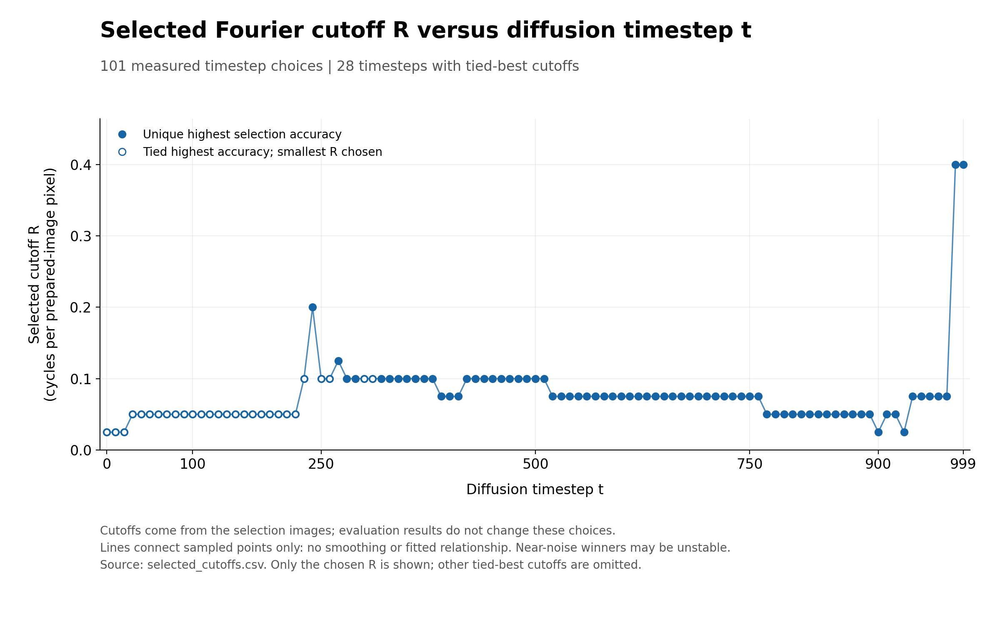
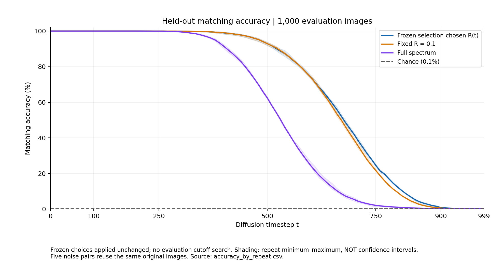
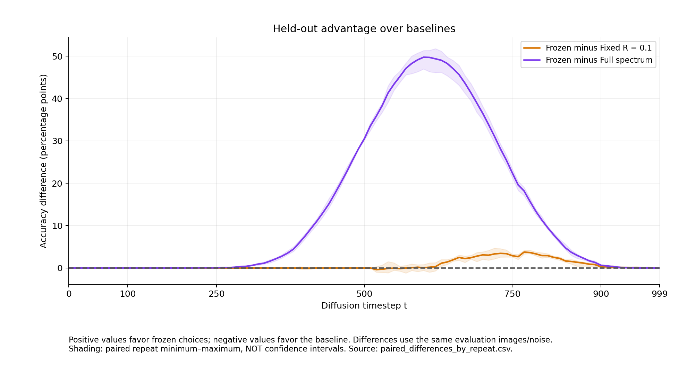
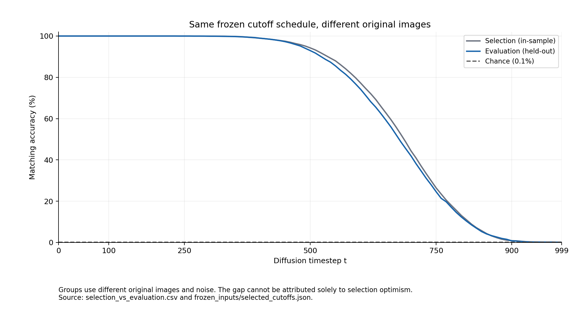

# Fourier cutoff selection across diffusion noise levels

**1,000 selection images and 1,000 held-out evaluation images**  

## Executive summary

This experiment asks which radial Fourier cutoff **R** best preserves image-identity matching as diffusion timestep **t** increases. We selected a cutoff separately at each of 101 timesteps using 1,000 CIFAR-10 images, then applied those choices unchanged to 1,000 different images.

The selected cutoff does not decrease smoothly across the entire timestep range. A clear section uses **R = 0.1 at t = 420–510**, **R = 0.075 at t = 520–760**, and **R = 0.05 at t = 770–890**. At 28 timesteps, multiple cutoffs tied for highest selection accuracy; the predefined rule chose the smallest R. These points do not establish a uniquely best cutoff. [1](data/selected_cutoffs.csv)

On held-out images at **t = 750**, the selected cutoff achieved **24.52%** matching accuracy, compared with **21.63%** for fixed R = 0.1 and **2.05%** for full spectrum. The selected schedule did not beat fixed R = 0.1 at every timestep. At t = 990 and 999, its accuracy was **0.08% and 0.09%**, around the **0.1% chance reference**. Cutoff choices in that region should not be interpreted as reliable optima. [2](data/evaluation_accuracy_summary.csv)

## 1. Research question and experimental setup

**Question:** As independently added diffusion noise increases, which range of Fourier frequencies is most useful for finding two noisy versions of the same original image?

The earlier pilot used 50 selection and 50 evaluation images. This experiment increased both groups to 1,000 while retaining the cutoff-selection method. Each matching query now has 1,000 candidates, compared with 50 in the pilot, so the task is harder and the chance reference changes from 2% to 0.1%.

| Setting | This experiment |
|---|---|
| Dataset | CIFAR-10 training split |
| Distinct originals | 2,000: 1,000 selection + 1,000 evaluation |
| Class balance | 100 images per class in each group |
| Separation | Groups have no shared image IDs; the previous 100-image pilot is excluded |
| Duplicate handling | Exact original/resized pixel duplicates are skipped during preparation |
| Image preparation | RGB 32 × 32 → 64 × 64, Pillow bilinear resizing, normalized to approximately −1 to 1 |
| Noise schedule | 1,000-step cosine schedule (`squaredcos_cap_v2`) |
| Sampled timesteps | 0, 10, 20, …, 980, 990, 999: **101 timesteps** |
| Noise repetitions | Five independent pairs of noise banks A and B per group |
| Matching directions | A → B and B → A |
| Candidates per query | 1,000 images from the opposite bank, within the same group |
| Compared evaluation methods | Frozen R(t), fixed R = 0.1, and full spectrum |

The 64 × 64 preparation matches the preceding experiment; resizing does not add new native image detail. “Held-out” means excluded from cutoff selection. These evaluation images still come from the CIFAR-10 **training split**, not its official test split.

This is a forward-noising and image-matching experiment. No diffusion-model training, denoising inference, LPIPS, or Mantel correlation is performed. Scheduler settings define the noise; trained model weights are not used. Preparation and analysis procedures are preserved in the [scripts](scripts/).

## 2. Noise banks and matching accuracy

Both banks contain the **same underlying originals**, with independently sampled noise. For example, the noisy version of image 17 in bank A should match image 17 in bank B, among all 1,000 candidates. A match to a different image of the same class is incorrect.

For each original image, bank, and repetition, the noisy state is:

$$
x_t = \sqrt{\bar\alpha_t}\,x_{\mathrm{clean}} + \sqrt{1-\bar\alpha_t}\,\epsilon.
$$

Here, the schedule determines how much original signal and Gaussian noise are present. The same noise tensor epsilon is reused across timesteps within one image/bank/repetition; a new independent pair is used in the next repetition. States are computed directly at the listed timesteps, rather than by repeatedly adding noise every ten steps. This is not a sampled step-by-step Markov trajectory.

Scheduler **t = 0 is slightly noised**, so a separate clean-image control is included. There is no scheduler index t = 1000. Preparation represents 2,020,000 noisy states (2,000 images × 2 banks × 5 repetitions × 101 timesteps), reconstructed as needed from saved images, seeds, and schedule.

For every timestep and method, accuracy is averaged across both matching directions and five repetitions: **10,000 directional queries per group**. These reuse the same 1,000 originals and are not 10,000 independent images. If several candidates tie for the shortest distance, a correct image among k tied candidates receives 1/k credit. Random matching has a reference accuracy of **1/1,000 = 0.1%**.

## 3. Fourier features and how R is selected

For each noisy image, the analysis:

1. Converts unclipped RGB values to grayscale using weights (0.299, 0.587, 0.114).
2. Subtracts the spatial mean and computes an orthonormal two-dimensional FFT.
3. Uses `log1p(abs(FFT)**2)` as the feature, discarding phase and excluding the DC bin.
4. Compares images using the root-mean-square difference between features in the selected frequency region.

The radius of a Fourier bin is:

$$
r = \sqrt{f_x^2 + f_y^2}.
$$

A cutoff R includes all bins satisfying **0 < r ≤ R**. Frequencies are in **cycles per prepared-image pixel**. A smaller R uses only lower frequencies; a larger R adds higher frequencies. R is a frequency boundary, not a correlation coefficient or a matching-accuracy threshold.

The 12 candidates were:

```text
R = 0.025, 0.05, 0.075, 0.1, 0.125, 0.15,
    0.2, 0.25, 0.3, 0.4, 0.5, and full spectrum
```

Full spectrum includes all non-DC bins, including corner frequencies above radius 0.5, up to approximately 0.7071. It is not equivalent to R = 0.5.

For each timestep, all 12 candidates were scored on the selection group. The candidate with the highest mean matching accuracy was chosen. Ties use the smallest R, with full spectrum ordered last. No smoothing was applied. These choices were **frozen**, meaning saved and left unchanged before evaluation. The evaluation stage scored the frozen choice and two baselines; it did not search for a new best cutoff.

FFT does not automatically remove noise. This experiment tests whether limiting the frequency features helps identity matching; it does not reconstruct a clean image.

## 4. Selected cutoff R versus timestep t



**How to read this graph:** the horizontal axis is diffusion timestep t; the vertical axis is the cutoff chosen on the selection images. Filled circles indicate a unique highest selection accuracy among the tested candidates. Hollow circles indicate a tie, resolved by choosing the smallest R. Connecting lines are visual guides, not a fitted relationship. Source: [1](data/selected_cutoffs.csv).

The following table groups consecutive sampled timesteps with the same choice. Ranges refer only to the sampled points, not every intermediate integer timestep.

| Sampled timestep(s) | Selected R |
|---|---:|
| 0–20 | 0.025 |
| 30–220 | 0.05 |
| 230 | 0.1 |
| 240 | 0.2 |
| 250–260 | 0.1 |
| 270 | 0.125 |
| 280–380 | 0.1 |
| 390–410 | 0.075 |
| 420–510 | 0.1 |
| 520–760 | 0.075 |
| 770–890 | 0.05 |
| 900 | 0.025 |
| 910–920 | 0.05 |
| 930 | 0.025 |
| 940–980 | 0.075 |
| 990, 999 | 0.4 |

Across the 101 choices, R = 0.05 was selected 35 times, R = 0.075 33 times, and R = 0.1 24 times. Full spectrum was never selected, although it tied for best at some early timesteps. There were **28 timesteps with tied-best candidates**. The [original plot showing all tied-best options](figures/selected_R_vs_t_with_ties.png) provides this additional context.

The middle-to-late portion shows a shift toward smaller cutoffs, but the whole curve is not monotonic. Early choices often reflect ties at very high accuracy. Late choices fluctuate when matching approaches chance. No Pearson/Spearman coefficient or universal R(t) formula is inferred from this plot.

## 5. Accuracy on the 1,000 held-out images



**How to read this graph:** at each timestep, the blue curve uses the R selected earlier; orange uses R = 0.1 throughout; purple uses full spectrum. Higher accuracy means more successful original-image matches. Shading shows the minimum–maximum across the five noise repetitions, **not confidence intervals**. Source: [2](data/evaluation_accuracy_summary.csv).

| t | Frozen R | Selection accuracy at that R | Evaluation: frozen R | Evaluation: fixed R = 0.1 | Evaluation: full spectrum |
|---:|---:|---:|---:|---:|---:|
| 250 | 0.1 | 99.99% | 99.99% | 99.99% | 99.96% |
| 500 | 0.1 | 94.24% | 92.93% | 92.93% | 62.38% |
| 750 | 0.075 | 26.37% | 24.52% | 21.63% | 2.05% |
| 800 | 0.05 | 13.05% | 12.32% | 9.40% | 0.99% |
| 900 | 0.025 | 0.85% | 0.79% | 0.54% | 0.17% |
| 990 | 0.4 | 0.13% | 0.08% | 0.08% | 0.11% |
| 999 | 0.4 | 0.13% | 0.09% | 0.12% | 0.11% |

Table sources: [selection results](data/selected_cutoffs.csv) and [evaluation results](data/evaluation_accuracy_summary.csv). Accuracies are percentages; stored CSV accuracy fields are fractions from 0 to 1.

At t = 750, using the selected R = 0.075 instead of full spectrum improved accuracy by **22.47 percentage points**. Its advantage over fixed R = 0.1 was **2.89 percentage points**. This supports the usefulness of a restricted frequency range for this matching task, while showing that adapting R gives a smaller gain than the full-spectrum comparison might suggest.

### Differences from the baselines



The vertical axis is **frozen accuracy minus baseline accuracy**, in percentage points. Positive values favor the frozen cutoff; negative values favor the baseline. Comparisons use the same evaluation images and noise within each repetition. Source: [3](data/paired_differences.csv).

- The largest observed advantage over fixed R = 0.1 was **3.74 percentage points at t = 770**.
- The frozen schedule performed **0.40 percentage points worse at t = 520** than fixed R = 0.1.
- The largest observed advantage over full spectrum was **49.77 percentage points at t = 600**: 74.17% versus 24.40% accuracy.

These are descriptive differences across the tested timesteps, not claims of statistical significance. The shaded ranges are paired repetition minimum–maximum, not confidence intervals.

### Selection and evaluation compared



Both curves use the same R(t) choices. The selection curve describes the images used to choose R; the evaluation curve describes different originals and independent noise. At t = 750, accuracy changed from **26.37% on selection** to **24.52% on evaluation**. The gap can reflect both selection optimism and differences between the image/noise samples; this experiment does not separate those effects. Sources: [1](data/selected_cutoffs.csv), [2](data/evaluation_accuracy_summary.csv).

## 6. Controls and verification

The evaluation controls covered the union of seven numeric cutoffs used by the frozen schedule and the full-spectrum baseline. Clean-image matching was **100% for all eight methods**. Pure-noise accuracy averaged across five repetitions ranged from **0.09% to 0.15%**, around the 0.1% chance reference. Source: [4](data/evaluation_control_accuracy.csv).

The [evaluation manifest](data/evaluation_analysis_manifest.json) records completion, no new cutoff search, and numerical agreement between direct and batched calculations on a 16-image probe at t = 0, 500, and 999. The recorded maximum distance error was approximately **9.44 × 10⁻¹⁶**.

A review of the downloaded summaries confirmed all 101 timestep choices, agreement between the chosen and applied cutoffs, valid accuracy bounds, and reconciliation of all 202 reported mean differences against their baseline accuracies. Eight downloaded outputs matched the checksums recorded in the supplied evaluation manifest. The packaged evaluation script also matches the script checksum in that manifest.

This is a summary-level review. Full selection score tables, query chunks, and prepared tensors were not included in the review download; FFT values, query-level matching, and optimality across every candidate were not independently recomputed. See the [review record](data/review_checks.json).

## 7. Interpretation and limits

The experiment identifies an empirical cutoff schedule among the **12 tested candidates**, then measures how that schedule transfers to different original images. It provides evidence that lower-frequency features can remain useful for identity matching under substantial noise, with larger gains over full spectrum than over the fixed low-frequency baseline in parts of the tested range.

The following limits matter:

- R(t) is not a unique optimum where candidates tie, and it is not an optimum over every possible real-valued radius.
- Near-chance matching does not support a reliable cutoff recommendation. In particular, the late jump to R = 0.4 is not evidence of useful high-frequency recovery.
- The five repetitions reuse the same originals; both matching directions and neighboring timesteps are dependent. No significance tests or confidence intervals are reported.
- Results depend on CIFAR-10, 64 × 64 resizing, the cosine schedule, the chosen Fourier representation, and the 1,000-candidate matching task. They do not establish a universal R(t) law.
- Discarding phase means Fourier-feature similarity is not the same as visual or semantic identity. No model memorization/generalization claim follows from this forward-noising experiment.
- Evaluation data should not be used to revise R(t) and then presented as an independent confirmation on those same images. A revised rule would require a fresh evaluation sample.

For subsequent work under these same settings, the frozen schedule can be retained as a tested method, with fixed R = 0.1 retained as a strong baseline. Any proposed smoothing or simplified R(t) rule should be selected without reusing these evaluation outcomes for tuning.

## Reproducibility and source files

The primary server directories are:

```text
/yunity/poil08/datasets
/yunity/poil08/cifar10_cutoff_1000_preparation_001
/yunity/poil08/cifar10_cutoff_1000_validation_001
/yunity/poil08/cifar10_cutoff_1000_selection_001
/yunity/poil08/cifar10_cutoff_1000_evaluation_001
```

The experiment used preparation, numerical validation, selection, then held-out evaluation in that order. The [scripts folder](scripts/) contains the corresponding four Python scripts and the standalone R-versus-t plotting script. The manifest records torch 2.9.1, NumPy 2.3.5, SciPy 1.17.0, Pillow 12.1.0, and Matplotlib 3.10.8. The original preparation files, frozen selection files, and detailed query chunks remain necessary for a complete rerun/audit; this GitHub package is a compact reporting bundle.

Sources included with this report:

1. [Selected cutoffs and selection accuracies, all 101 timesteps](data/selected_cutoffs.csv).
2. [Held-out accuracy summaries, three methods per timestep](data/evaluation_accuracy_summary.csv).
3. [Paired accuracy differences against the two baselines](data/paired_differences.csv).
4. [Clean and pure-noise controls](data/evaluation_control_accuracy.csv).
5. [Evaluation manifest and recorded checksums](data/evaluation_analysis_manifest.json).
6. [Local summary-review record](data/review_checks.json).

All figures use relative links. Keep this README, `figures/`, `data/`, and `scripts/` together when uploading the report to GitHub.
