# CIFAR-10 corruption experiment: input verification and visual pilot

full generation and matching experiments pending

## Executive summary

We prepared the same 2,000 CIFAR-10 training images used for the recent selection/evaluation study, verified their identities and pixels, and implemented 15 corruption types at five severity levels using an adaptation of the CIFAR-10-C reference procedure. The server's technical validation reported 450 passing corruption cases and reproduction of all 75 conditions in a fresh Python process.

The visual pilot then saved **750 corrupted images from ten selection images**, along with ten clean images and 25 comparison panels. The researcher reported that the corruptions appeared successful on initial visual inspection. This supports proceeding to full generation; it does not establish matching accuracy or exact equivalence to the released CIFAR-10-C benchmark. No similarity metrics have been computed in this corruption experiment. [1](evidence/pilot_manifest.json)

## 1. Research question and experimental setup

The planned question is: **How reliably can different image-similarity methods identify a clean original when its query image is corrupted?** The present report covers preparation and visual inspection only. Conditions are defined by corruption type and severity, rather than diffusion timestep *t*.

| Setting | Current setup |
|---|---|
| Source dataset | CIFAR-10 training images stored on the GPU server |
| Selection group | 1,000 images, 100 per class |
| Evaluation group | 1,000 separate images, 100 per class |
| Image separation | 2,000 distinct originals; the earlier 100-image study's IDs excluded |
| Native corruption resolution | 32×32 RGB, integer pixel values 0–255 |
| Visual pilot | Ten selection images, one per class |
| Pilot selection rule | First image in saved selection order for each class, without inspecting corruption outcomes |
| Conditions | 15 corruption types × five severity levels |
| Randomization | One realization per image/condition; repetition index 0; |
| Pilot output | 10 × 15 × 5 = **750 corrupted images** |
| Evaluation use in Steps 2–3 | Evaluation image arrays not opened; no evaluation scores computed |

The Step 1 server completion output reported exact matches to the original 32×32 images and the previous 64×64 versions. Corruption is applied to the **32×32 originals**. Any later resizing for matching is a separate operation after corruption. The source verification and validation screenshots supplied during the run support the Step 1–2 status; their original JSON reports are not included in this upload package. The pilot manifest records their input/report hashes.

Each condition starts from the clean original. Severity 2 is not produced by corrupting the severity-1 image again. Different stochastic seeds are used across severities, so a single example need not look strictly more damaged at every successive level. Severity numbers are reference settings, not equal amounts of distortion across corruption types.

## 2. How the corruption procedure was implemented

The generator adapts the authors' [CIFAR-specific source code](https://github.com/hendrycks/robustness/blob/8190fe329f5f072a06e3a2aea02bb5dda69aed9f/ImageNet-C/create_c/make_cifar_c.py), retaining its severity parameters and native-size operations. Modern Python/library compatibility changes and explicit per-image random seeds were added. This study uses custom corruptions of selected **training** images; it does not use the official released CIFAR-10-C test images.

| Family | Corruptions included |
|---|---|
| Noise | Gaussian noise, shot noise, impulse noise |
| Blur | Defocus blur, glass blur, motion blur, zoom blur |
| Weather-style effects | Snow, frost, fog |
| Other appearance/digital changes | Brightness, contrast, elastic transform, pixelation, JPEG compression |

All five parameter settings for each corruption are available in [severity_parameters.json](evidence/severity_parameters.json). Each saved PNG is lossless: reading it back was checked against the generated pixel array. This includes JPEG-corrupted outputs, where the JPEG degradation is applied first and its decoded pixels are then preserved in PNG format.

## 3. Actual corrupted images: how to read the panels

**Rows identify the same ten source images. Columns show Clean → Severity 1 → 2 → 3 → 4 → 5.** Panel pixels are enlarged four times with nearest-neighbor interpolation for inspection. The underlying images remain 32×32; the enlargement adds no new image detail.

### Figure 1. Gaussian noise

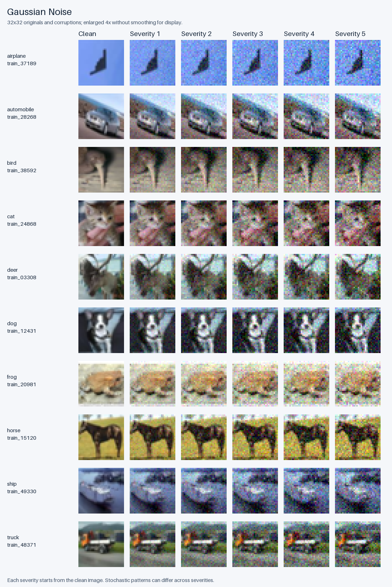

Fine pixel-level fluctuations are visible relative to the clean column and become more prominent overall toward the higher settings. This is a qualitative observation from these examples, not a measurement of retrieval performance. The reference Gaussian standard deviations are 0.04, 0.06, 0.08, 0.09 and 0.10 on the 0–1 pixel scale before clipping and conversion back to integer pixels.

### Figure 2. Motion blur

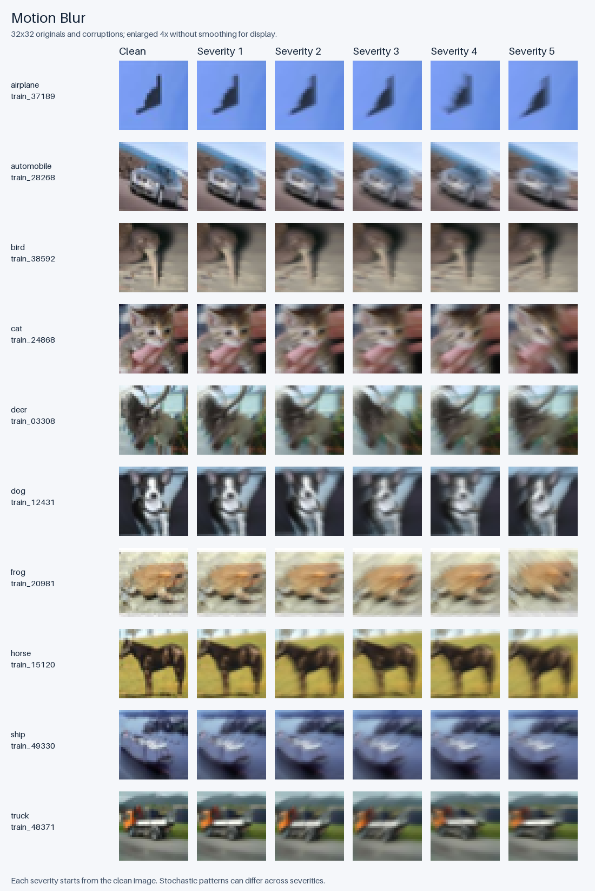

Edges and fine details are softened or smeared relative to the clean images. The blur direction can change across severity columns because each condition has its own random seed. A higher severity therefore does not represent the same blur pattern simply intensified.

### Figure 3. Brightness

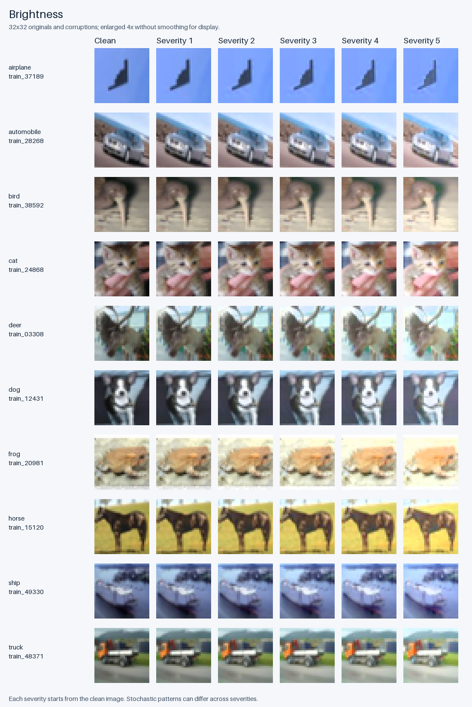

The images become brighter across the displayed settings, and some already-light areas lose visible detail. These panels demonstrate appearance changes; they do not establish how much each matching method will be affected.

### Remaining corruption panels

Open a section below to view its full panel. All 15 corruption types are represented in this report; the three above are shown first to illustrate different kinds of changes.

Shot Noise: clean and five severities

Impulse Noise: clean and five severities

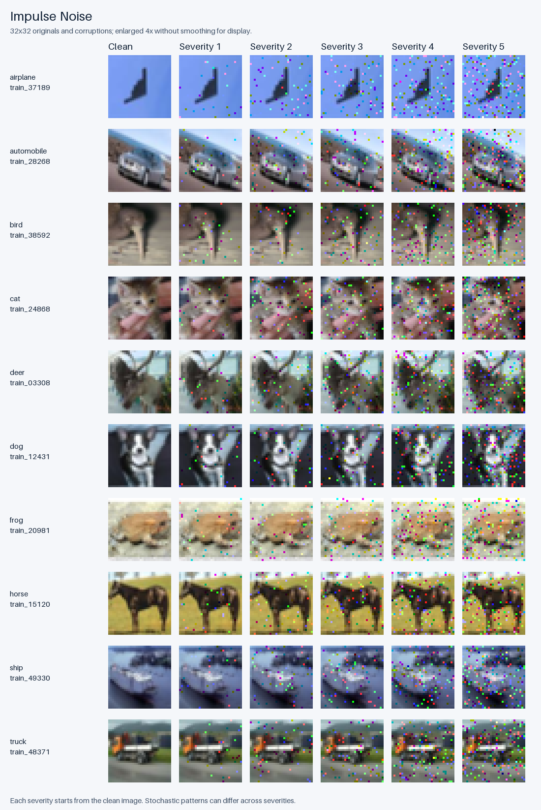

Defocus Blur: clean and five severities

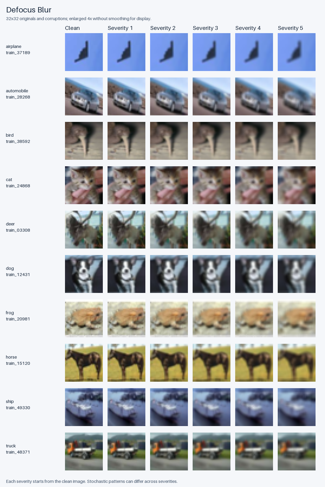

Glass Blur: clean and five severities

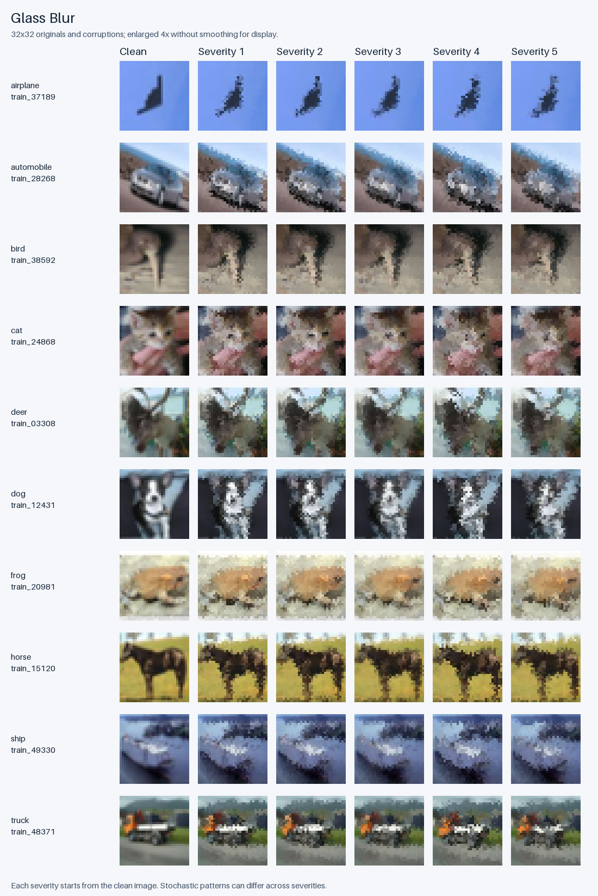

Zoom Blur: clean and five severities

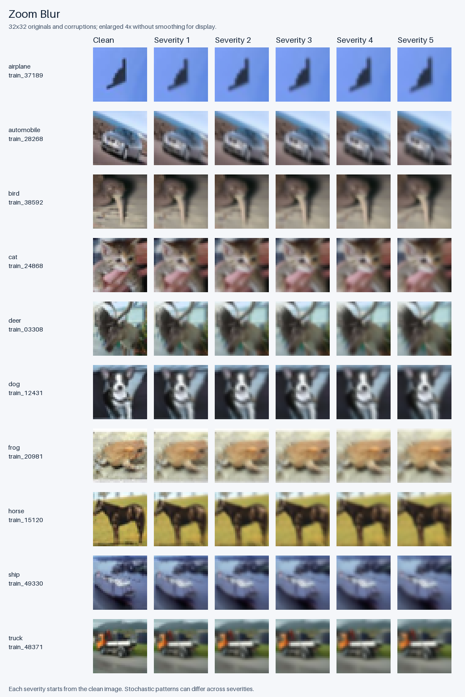

Snow: clean and five severities

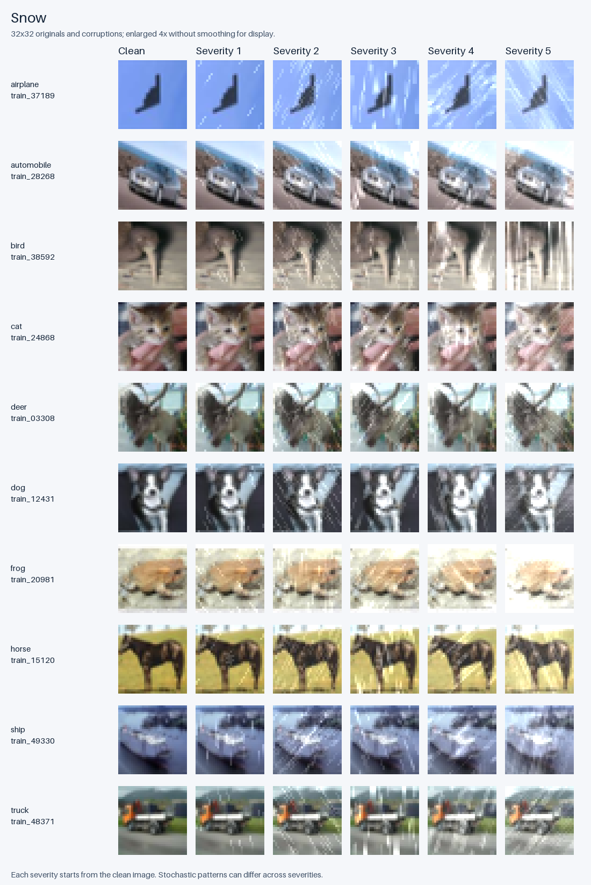

Frost: clean and five severities

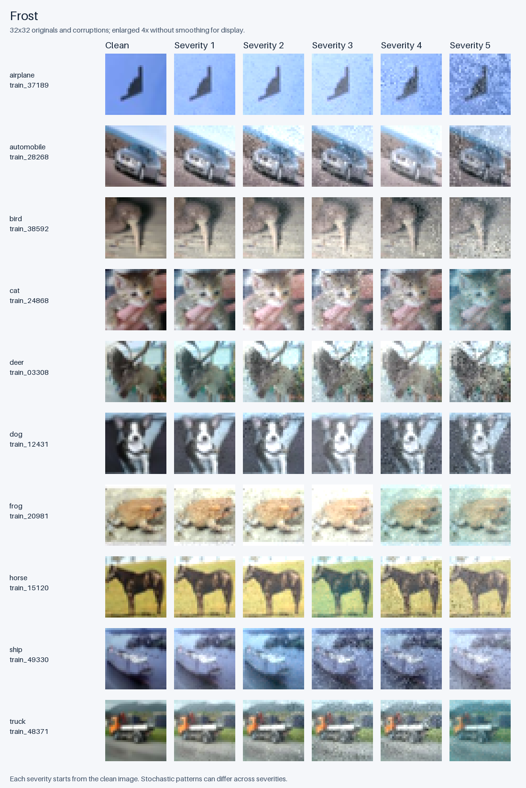

Fog: clean and five severities

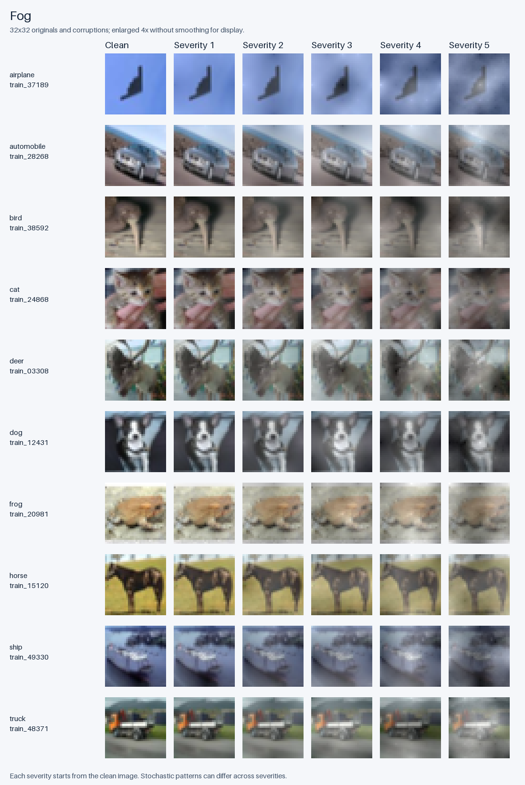

Contrast: clean and five severities

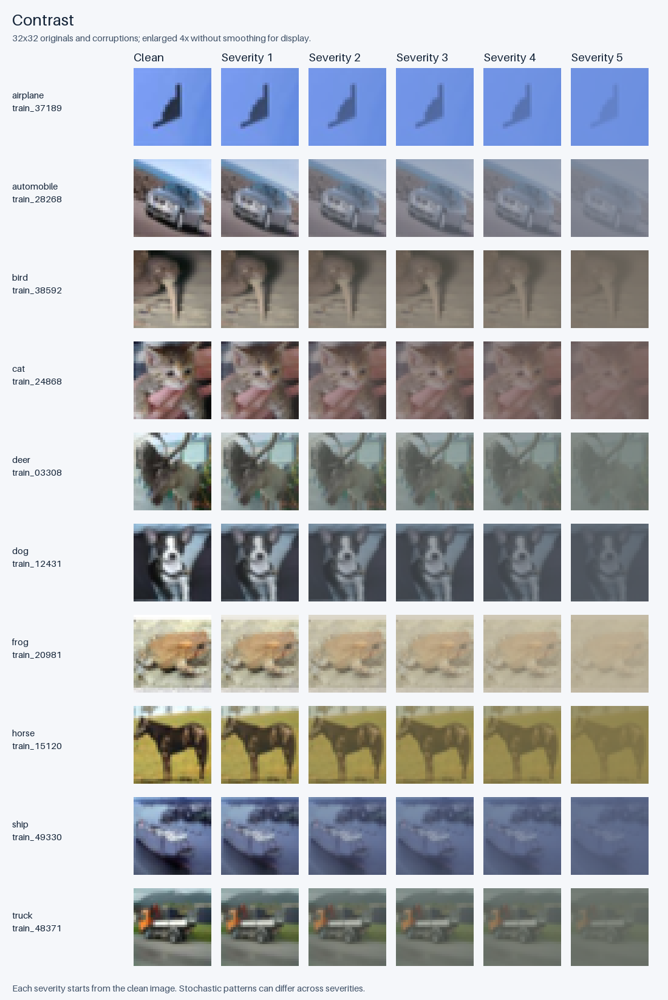

Elastic Transform: clean and five severities

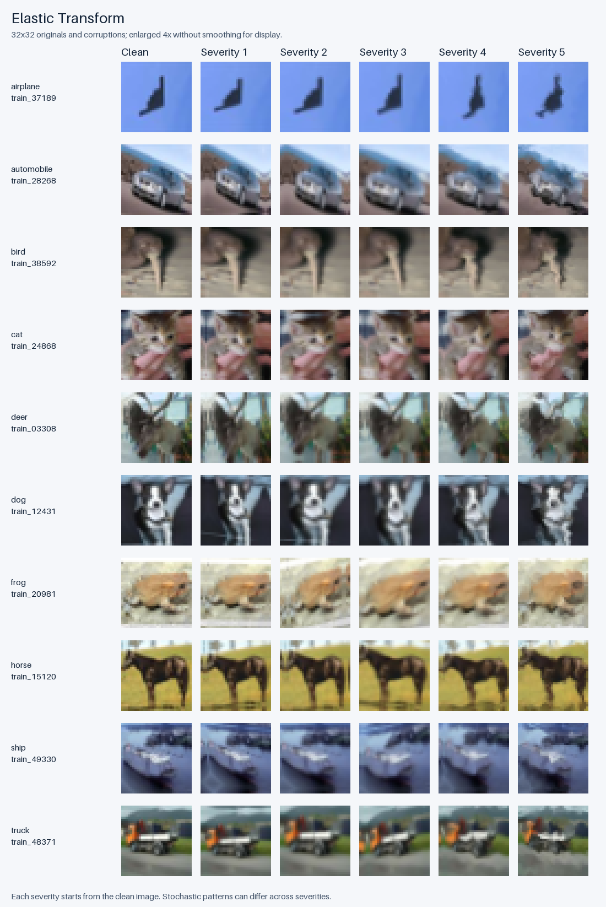

Pixelate: clean and five severities

Jpeg Compression: clean and five severities

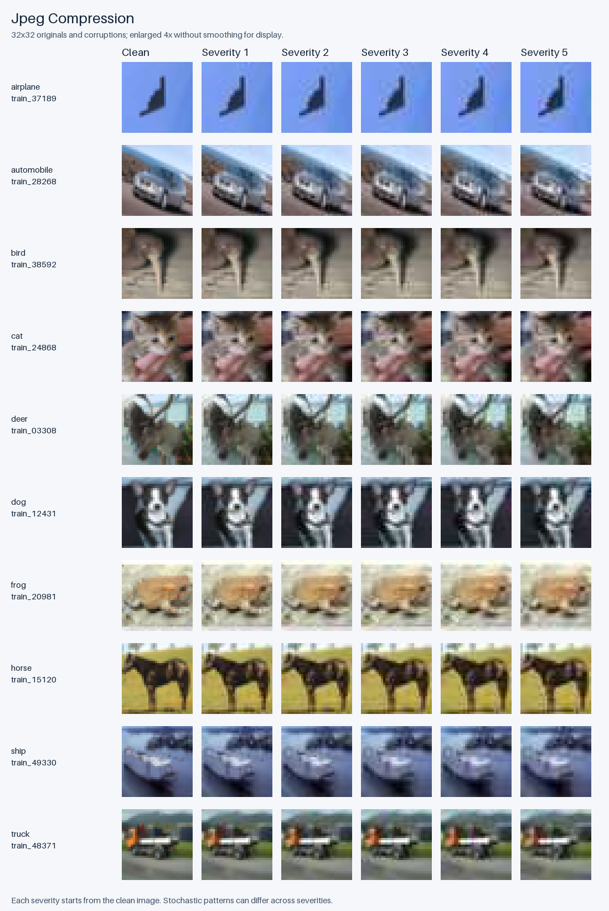

### View all corruptions for one source image

These ten additional panels show 15 corruption rows for a single original. They help distinguish changes due to corruption type from differences between source images. Image IDs refer to individual originals, not just class labels. [2](evidence/selected_images.json)

| Class | Original image ID | All-corruption panel |
|---|---|---|
| airplane | `train_37189` | [View panel](figures/by_image/train_37189.png) |
| automobile | `train_28268` | [View panel](figures/by_image/train_28268.png) |
| bird | `train_38592` | [View panel](figures/by_image/train_38592.png) |
| cat | `train_24868` | [View panel](figures/by_image/train_24868.png) |
| deer | `train_03308` | [View panel](figures/by_image/train_03308.png) |
| dog | `train_12431` | [View panel](figures/by_image/train_12431.png) |
| frog | `train_20981` | [View panel](figures/by_image/train_20981.png) |
| horse | `train_15120` | [View panel](figures/by_image/train_15120.png) |
| ship | `train_49330` | [View panel](figures/by_image/train_49330.png) |
| truck | `train_48371` | [View panel](figures/by_image/train_48371.png) |

## 4. What the technical validation established

One test case means one image × one corruption type × one severity. Step 2 used **three actual selection images plus three synthetic probes** (black, white and a color gradient), giving **6 × 15 × 5 = 450 distinct cases**. This is a test-case count, not an accuracy percentage or a test of all 2,000 originals.

| Check | Reported outcome and interpretation |
|---|---|
| Source/identity checks | Saved selection inputs and IDs agreed with the completed input-verification record |
| Output format | Correct 32×32 RGB shape; finite pixel values within 0–255 |
| Input preservation | Clean source arrays were not changed by corruption generation |
| Same-seed repeatability | Identical pixels on repeated calls with the same input and seed |
| Processing order | Reversing the job order did not alter results |
| Fresh Python process | All 75 corruption/severity conditions for one selection image reproduced exactly |
| Reference settings | Five severity parameter settings matched the bundled reference for all 15 types |
| Independent formula check | Gaussian noise matched a separately calculated formula at each severity |
| Pilot file integrity | All 750 generated PNGs passed a save/read-back pixel comparison |

The pilot script checked the completed validation report and required the same generator, input hashes and runtime before proceeding. During report assembly, all **790 artifacts listed in the pilot manifest** matched their recorded file hashes, and the CSV contained exactly 750 unique image/corruption/severity combinations. These hashes establish file integrity, not scientific correctness.

**Limits:** reproducibility alone does not prove an algorithm is correct. All 15 severity tables were compared, but a separate mathematical output check was implemented only for Gaussian noise. Modern library versions may differ from those used for the original benchmark release. Visual inspection complements these tests and does not prove pixel-for-pixel benchmark equivalence.

## 5. Pilot outcome and current interpretation

| Quantity | Observed output |
|---|---:|
| Distinct pilot originals | 10 |
| Corruption types | 15 |
| Severities per type | 5 |
| Corrupted images per type | 50 |
| Total corrupted images | 750 |
| Clean PNGs | 10 |
| Panels organized by corruption | 15 |
| Panels organized by source image | 10 |

The researcher reported that the pilot appeared successful on initial visual inspection. This is a qualitative review rather than a quantitative assessment across all images. The unmodified machine-generated manifest still says `visual_review_status: pending` because it was written before that review; this report records the subsequent researcher feedback separately.

The completed work demonstrates that the pilot can be generated, saved, reproduced and inspected using a documented procedure. It supports moving to full generation with the same configuration. It does **not** show that one similarity method outperforms another, establish an optimal Fourier cutoff, or demonstrate memorization/generalization.

## 6. Planned next experiment — not yet performed

1. Generate the same 75 conditions for all 1,000 selection and 1,000 evaluation originals: **150,000 corrupted images**. Preserve image identities and seeds, and verify overlap with the saved pilot.
2. Validate the six matching implementations: LPIPS, SSIM, Fourier features, SSCD, PSNR and MSE. Document each method's required preprocessing before comparing results.
3. For each corrupted query, search the 1,000 clean originals in its own group. A correct top match means finding the **same original image**, not simply another member of its class.
4. Use the selection group to settle adjustable choices, including any Fourier cutoffs. Freeze those choices before examining evaluation scores.
5. Report held-out matching accuracy by corruption type and severity. Decide and document tie handling before scoring. Uniform random selection among 1,000 candidates has expected accuracy **0.1%**.

These steps are planned; the current pilot contains no LPIPS, SSIM, Fourier, SSCD, PSNR or MSE results. Corruption severity replaces diffusion timestep as the condition axis for this experiment.

## 7. Reproducibility and evidence files

| Item | Recorded value |
|---|---|
| Repetition index | 0 |
| Python | 3.12.16 |
| NumPy / SciPy | 2.2.6 / 1.15.3 |
| Pillow / scikit-image | 11.3.0 / 0.25.2 |
| OpenCV headless / Wand | 4.12.0.88 / 0.6.13 |
| ImageMagick | 7.1.2-31 Q16-HDRI, x86_64 |

Per-image seeds are derived from the master seed, image ID, corruption, severity and repetition using SHA-256. The exact seed recipe, source commit, generator hash, input hashes and runtime are preserved in the manifest. Reproduction is scoped to the recorded implementation/environment; identical results across platforms or library versions are not guaranteed.

- [Pilot manifest](evidence/pilot_manifest.json): execution status, counts, selected IDs, runtime and original artifact hashes.
- [Pilot image records](evidence/pilot_images.csv): 750 rows containing image ID, corruption, severity, seed and saved-image hashes.
- [Selected image identities](evidence/selected_images.json): one original per class and its saved selection position.
- [Severity parameter settings](evidence/severity_parameters.json): all five settings for each corruption.
- [Reference CIFAR corruption implementation](https://github.com/hendrycks/robustness/blob/8190fe329f5f072a06e3a2aea02bb5dda69aed9f/ImageNet-C/create_c/make_cifar_c.py): pinned upstream source used by the generator.

The GitHub report package contains all 25 panels and four supporting evidence files. The complete 750 individual corrupted PNGs and ten clean PNGs remain in the original `cifar10_corruption_pilot_001` archive. Paths inside the unchanged manifest/CSV refer to that full archive; not every raw artifact is duplicated here.
